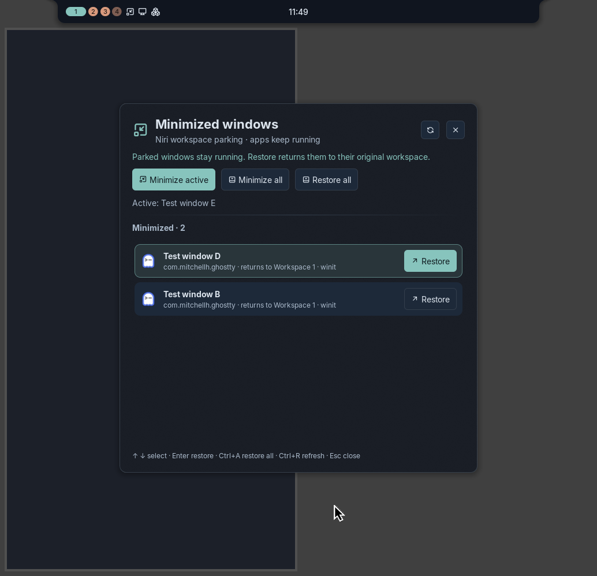

# Noctalia Minimizer

Reversible window minimization for the [Niri](https://github.com/YaLTeR/niri) Wayland compositor,
as a native [Noctalia Shell](https://noctalia.dev) v5 plugin.

Niri is a scrollable-tiling compositor and has no "minimized" window state. This plugin emulates
it safely with **workspace parking**: a minimized window is moved (without focus) to a reserved,
named workspace and remembered together with its original workspace. Restoring moves it back.
Applications keep running the whole time; nothing is closed, killed or hidden from Niri.



## Features

| | |
|---|---|
| `Super+M` | Minimize the focused window |
| `Super+Shift+M` | Open the **Minimized windows** panel |
| Panel | List minimized windows with app icon, title, app id and the workspace each returns to; restore one, restore all, minimize the active window, minimize all (with confirmation) |
| Keyboard | `↑`/`↓` select · `Enter` restore · `Ctrl+A` restore all · `Ctrl+R` refresh · `Esc` close |
| Bar widget | Left click minimizes, right click opens the panel |
| Control-center tile | "Minimize active window" |
| Taskbar restore | Selecting a parked window in Noctalia's taskbar/switcher restores it (optional) |
| Optional bindings | Minimize all, restore all, restore last (NixOS module options) |

Behaviour details:

- **Multiple windows, workspaces and monitors.** Each window remembers its own origin workspace
  (by Niri workspace id), including workspaces on other outputs. The parking workspace is an empty
  workspace on the focused output.
- **Origins are kept alive.** If minimizing empties an unnamed workspace, it is temporarily named
  `Restore <id>` so Niri does not delete it; the name is removed again when its last window
  returns or closes. Workspace names you set yourself are never changed.
- **Closed windows.** A window closed while minimized is dropped from the list automatically and
  any temporary names are released.
- **Focus.** Minimizing never moves focus to the parked window. Restoring a single window focuses
  it; *Restore all* leaves focus where it is.
- **Restarts.** State is kept in `$XDG_STATE_HOME/noctalia-minimizer/windows.json` (mode 0600)
  and survives Noctalia restarts. A new Niri session invalidates old window ids, so stale state is
  discarded.
- **Migration.** Windows parked by the older "Desk Tools" plugin in the same Niri session are
  adopted once (its state file is read, never modified).

## Requirements

- Niri with JSON IPC (developed and tested on **Niri 26.04**).
- Noctalia **v5**, plugin API 24 or later (tested on **5.0.1**, API 30).
- Python 3 (standard library only; supplied by the Nix package).
- Linux. Other compositors are not supported; the panel says so instead of failing silently.

## Installation

### NixOS with flakes

```nix
# flake.nix
{
  inputs.nixpkgs.url = "github:NixOS/nixpkgs/nixos-26.05";
  inputs.noctalia-minimizer.url = "github:SwashX-dev/noctalia-minimizer";
  inputs.noctalia-minimizer.inputs.nixpkgs.follows = "nixpkgs";

  outputs = { nixpkgs, noctalia-minimizer, ... }: {
    nixosConfigurations.myhost = nixpkgs.lib.nixosSystem {
      system = "x86_64-linux";
      modules = [
        ./configuration.nix
        noctalia-minimizer.nixosModules.default
        { programs.noctalia-minimizer.enable = true; }
      ];
    };
  };
}
```

> The repository is private. Nix can only fetch it with credentials: add
> `access-tokens = github.com=<token>` to the `nix.conf` of the user that evaluates the
> configuration, or use `git+ssh://git@github.com/SwashX-dev/noctalia-minimizer` with an SSH key.
> Alternatively use a local checkout: `inputs.noctalia-minimizer.url = "path:/path/to/noctalia-minimizer";`.

### NixOS without flakes (channels)

The module does not depend on flake inputs, so it can be imported directly from a checkout:

```nix
# configuration.nix
{
  imports = [ ./vendor/noctalia-minimizer/nix/module.nix ];  # a copy kept next to configuration.nix
  programs.noctalia-minimizer.enable = true;
}
```

Keep the checkout somewhere only root can modify (for example `/etc/nixos/vendor`), because the
module is evaluated by `nixos-rebuild`.

Then build first, and switch only if the build succeeds:

```bash
sudo nixos-rebuild build && sudo nixos-rebuild switch
```

### Other systems with Nix (per user)

```bash
nix profile add github:SwashX-dev/noctalia-minimizer
```

This installs `noctalia-minimizer`, `noctalia-minimizer-setup` and the plugin under
`~/.nix-profile/share/noctalia-minimizer/plugins`. Key bindings are then set up with the setup tool
(below), using the shipped binding file.

### What gets installed

| Path | Purpose |
|---|---|
| `bin/noctalia-minimizer` | JSON CLI used by the plugin (`status`, `minimize`, `minimize-all`, `restore --id N`, `restore-all`, `restore-last`) |
| `bin/noctalia-minimizer-setup` | Per-user Noctalia + Niri integration helper |
| `share/noctalia-minimizer/plugins/minimizer/` | The Noctalia plugin (`local/minimizer`) |
| `share/noctalia-minimizer/niri-binds.kdl` | Default Niri bindings |
| `/etc/noctalia-minimizer/niri-binds.kdl` | Bindings generated from the module options (NixOS) |

No service, daemon, root helper or PolicyKit rule is installed.

## Enabling the plugin and shortcuts

After installing, run once as your normal user (inside your Niri session):

```bash
noctalia-minimizer-setup check
```

It prints the Niri config it found, the keys it wants, any **conflicting bindings** (including in
`include`d files) and whether the plugin is registered. Then:

```bash
noctalia-minimizer-setup apply
```

`apply`:

1. refuses to continue if a key is already bound (nothing is changed);
2. backs up your Niri config to `~/.local/state/noctalia-minimizer/backups/<time>/`;
3. appends one marked line, `include optional=true "/etc/noctalia-minimizer/niri-binds.kdl"`
   (or the profile's binding file), and validates the result with `niri validate` before writing;
4. registers the plugin directory as a Noctalia path source and enables `local/minimizer`
   through Noctalia's IPC (`noctalia msg plugins source add …`, `noctalia msg plugins enable …`).

Niri reloads its config automatically. Because the include is `optional=true`, uninstalling the
package later never breaks your Niri config.

Conflicts:

- `--replace-desk-tools` replaces only the `Mod+M` / `Mod+Shift+M` lines inside an existing
  `// BEGIN DESK TOOLS … // END DESK TOOLS` block (the original plugin this project came from).
- `--replace KEY` comments out (does not delete) a conflicting binding in your main config.
- Or choose different keys (module options below, or edit the binding file).

Manual alternative: add the include line yourself, and in Noctalia's settings add a path source
pointing at `/run/current-system/sw/share/noctalia-minimizer/plugins`, then enable "Minimizer".
To put the button on a bar, add a widget of type `local/minimizer:minimize-button`:

```toml
# ~/.config/noctalia/config.toml (merge with your existing bar lists)
[widget.minimize]
type = "local/minimizer:minimize-button"

[bar.default]
start = ["workspaces", "minimize"]
```

The binding file contains:

```kdl
binds {
    Mod+M hotkey-overlay-title="Minimize active window" { spawn "noctalia" "msg" "plugin" "local/minimizer:actions" "all" "minimize"; }
    Mod+Shift+M hotkey-overlay-title="Minimized windows" { spawn "noctalia" "msg" "plugin" "local/minimizer:actions" "all" "windows"; }
}
```

The service also accepts the events `minimize-all`, `restore-all` and `restore-last`.

## Configuration

### NixOS module options

| Option | Default | |
|---|---|---|
| `programs.noctalia-minimizer.enable` | `false` | Install the package and plugin |
| `programs.noctalia-minimizer.package` | built from this repository | |
| `programs.noctalia-minimizer.keybindings.enable` | `true` | Generate `/etc/noctalia-minimizer/niri-binds.kdl` |
| `….keybindings.minimize` | `"Mod+M"` | `null` to omit |
| `….keybindings.panel` | `"Mod+Shift+M"` | `null` to omit |
| `….keybindings.minimizeAll` | `null` | Minimize every window, no confirmation |
| `….keybindings.restoreAll` | `null` | |
| `….keybindings.restoreLast` | `null` | Most recently minimized window |

The module asserts that the chosen chords are distinct. It cannot see your per-user Niri config,
so use `noctalia-minimizer-setup check` to detect conflicts there.

### Plugin settings (Noctalia → Settings → Plugins → Minimizer)

| Key | Default | |
|---|---|---|
| `enabled` | `true` | Disables every action when off |
| `auto_restore` | `true` | Restore a parked window when it is focused from the taskbar. Uses one idle `niri msg --json event-stream` process while the plugin is loaded; reload the plugin after changing it |
| `confirm_minimize_all` | `true` | Ask before *Minimize all* in the panel |

Environment: `NOCTALIA_MINIMIZER_PARKING_NAME` changes the reserved workspace name (default
`Noctalia Minimized`).

## Troubleshooting

- **"Window parking requires a running Niri session"** — run inside Niri; if several sessions
  exist, set `NIRI_SOCKET`. Another user's socket is never used.
- **"A workspace named 'Noctalia Minimized' already exists without this session's state"** — the
  plugin will not take over a workspace it did not create. Move its windows out with Niri's normal
  workspace navigation and unname it (`niri msg action unset-workspace-name "Noctalia Minimized"`).
- **"No empty Niri workspace is available"** — Niri normally keeps an empty workspace at the end
  of each output; switch to it once or open a new workspace.
- **A window is stuck on the parking workspace** — it is an ordinary workspace: navigate to it and
  move the window, or run `noctalia-minimizer restore-all`.
- **Nothing happens on Super+M** — `noctalia-minimizer-setup check`; `noctalia msg plugins list`
  must show `local/minimizer … enabled`; check `~/.cache/noctalia/noctalia.log`.

## Updating

Flakes: `nix flake update noctalia-minimizer`, then rebuild. Channels: update your copy of the
repository, then rebuild. Profile: `nix profile upgrade noctalia-minimizer`. State files are
forward compatible; restore parked windows first if you want to be extra careful.

## Uninstalling and rollback

1. Restore parked windows: `noctalia-minimizer restore-all`.
2. `noctalia-minimizer-setup undo` restores the Niri config backed up by `apply` (it refuses if
   the file was edited afterwards; inspect the backup or pass `--force`) and disables the plugin
   and its source. `noctalia-minimizer-setup remove` instead removes only the managed include line.
3. Remove the module (or `nix profile remove noctalia-minimizer`) and rebuild. A NixOS rollback
   (`sudo nixos-rebuild switch --rollback`, or an older generation in the boot menu) returns to the
   previous system at any time; the `optional=true` include keeps Niri working either way.
4. Delete `~/.local/state/noctalia-minimizer` once nothing is parked.

## Known limitations

- This is workspace-based emulation, not a native hidden state: the parking workspace is visible
  in Niri's workspace list and overview.
- Restoring returns a window to its original **workspace**; exact column position, tab grouping
  and floating coordinates are not restored (Niri IPC offers no way to re-insert a window at a
  saved column index).
- Restoring into a workspace that Niri removed (for example after an output was unplugged) falls
  back to the focused workspace.
- Only Niri is supported.

## Development and tests

```bash
nix flake check -L          # unit tests, Luau compile, Noctalia linter, niri validate, module, NixOS VM test
nix build .#default -L
PYTHONPATH=backend python3 -m unittest discover -s tests -v   # without Nix
```

What is tested and how:

| Test | Kind |
|---|---|
| `tests/test_windows.py` (minimize/restore, multiple windows, two outputs, closed windows, new windows, renamed workspaces, IPC failures, legacy adoption, private files) | **Mocked** Niri IPC |
| `tests/test_cli.py`, `tests/test_setup.py` (conflicts, includes, backup/undo, replace) | Mocked / temporary files |
| `checks.plugin` | Real `luau-compile` and `noctalia plugins lint` on the installed plugin |
| `checks.niri-binds` | Real `niri validate` on both binding files |
| `checks.vm` | NixOS VM: module install, CLI error handling without Niri, setup apply/undo |
| `tests/live/niri_live_test.py` | **Live**: real Niri 26.04 (nested session, disposable windows). Run manually; refuses to touch non-test windows |

The live test passed during development (16/16 checks: minimize active, restore one, restore last,
restore all across two workspaces, closed minimized window, focus behaviour, IPC failure). The
panel, bar button and the `Super+M` command path were also exercised in a real Noctalia 5.0.1
instance inside that nested session; the screenshot above is from it.

## License

MIT — see [LICENSE](LICENSE).
